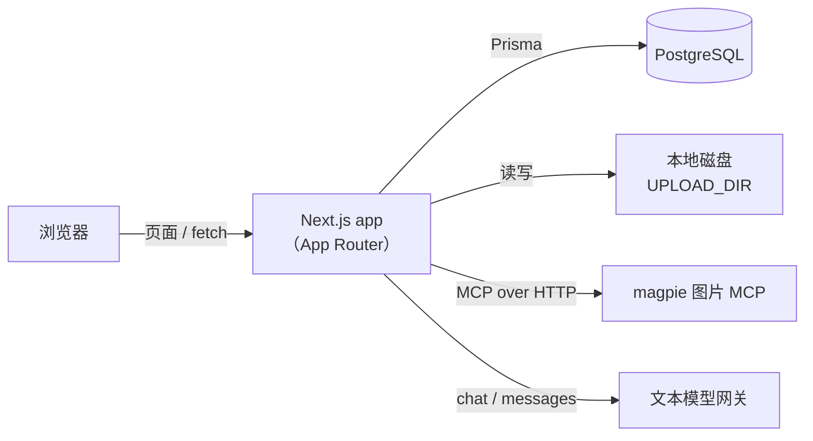

# 架构与工程约定

> 解释「代码怎么组织、为什么这样分层」。改动跨模块结构先改这里；决策背景见 `docs/adr/`。

## 1. 全景

单个 Next.js 应用（App Router）同时承担页面与接口，PostgreSQL 存业务数据，本地磁盘存图片。
没有独立后端服务、没有消息队列、没有对象存储 —— 单用户自托管场景下这些都是额外运维成本。



## 2. 分层

```
src/app/            # 路由层：页面与 /api 路由，只做参数解析 + 调用 service + 组装响应
src/modules/<域>/   # 业务层：schema(zod) / service / repo / prompt / 适配器 / 单测
src/lib/            # 横切能力：env、错误、响应信封、路由包装器、日志、加密
src/components/     # 通用 UI：Panel、EmptyState、Toast、ConfirmDialog、FeatureGate…
prisma/             # schema 与迁移
tests/e2e/          # 端到端验收
```

依赖方向单向：`app → modules → lib`，`modules → prisma`。
`lib` 不允许 import `modules`；模块之间只能通过对方导出的 service 函数交互，不能直接读别的模块的表。

## 3. 数据层

- ORM 统一用 Prisma（ADR 0001）。schema 放在 `prisma/schema/` 下**按领域拆分多个 `.prisma` 文件**
  （Prisma 的多文件 schema），一个功能模块只改自己那个文件，减少并行开发时的冲突。
- 迁移由 `prisma migrate` 生成，**迁移目录随代码提交**。
- 生产升级：容器启动时执行 `prisma migrate deploy`，失败则容器不启动，不带旧结构接流量。
- 结构版本由 `_prisma_migrations` 的已应用条数派生，健康检查返回它。
- 破坏性变更（删列、改名）拆成两个版本：先加新列并双写，后续版本再删旧列。

## 4. 关键横切点

### 响应信封

`/api` 成功 `{ ok: true, data }`；失败 `{ ok: false, error: { code, message, details? } }`。
`route()` 包装器把 `AppError` / `ZodError` / 未知异常翻译成状态码，**路由里不手写错误 JSON**。

错误码：`VALIDATION_FAILED`、`NOT_FOUND`、`CONFLICT`、`UNAUTHORIZED`、`FORBIDDEN`、
`UPSTREAM_FAILED`、`INTERNAL`；业务子码放 `details`（如 `AGENT_NOT_READY`、`FEATURE_DISABLED`、
`FEATURE_NOT_IMPLEMENTED`、`SERVER_RESTARTED`、`TIMEOUT`）。

### 功能开关（ADR 0003）

三层：代码里的注册表 → `feature_flag` 表 → 唯一判定入口。
实际可用 = `registry.implemented && (row.enabled ?? registry.defaultEnabled)`。
接口入口调用 `requireEnabled(key)`；界面入口用 `<FeatureGate feature="...">`。
业务代码里不允许出现按 key 判断的 if。

### 配置与密钥

- 只有「这台机器怎么跑」进环境变量（`src/lib/env.ts` 唯一入口）。
- 业务配置（网关、模型、提示词、提取要求、平台选项）在数据库或模块常量文件里，不散落在组件里。
- 网关 API Key 加密入库，密钥由 `AUTH_SECRET` 派生（HKDF），不复用会话签名密钥。
- 日志统一走 `src/lib/logger.ts`，对 `key|token|secret|password|authorization|cookie` 字段与
  `sk-…`、`Bearer …` 形态脱敏。

### 会话与账号（ADR 0006）

- `user` + `session` 两张表；密码用 Node 内置 `scrypt`，会话令牌只存 SHA-256，因此登出与改密码能真失效。
- 会话校验集中在 `getCurrentUser()`；`proxy.ts` 只做「无 cookie 跳登录」的快速判断，不查库。
- 页面放在 `src/app/(app)/` 路由组（受保护），`/login` 与 `/api/auth/*`、`/api/health` 在白名单。
- 未登录：页面 302 到 `/login?next=...`，接口 401 JSON，二者不可混用。
- 现在不做工作区维度；所有数据访问集中在模块 `repo.ts`，将来引入 `workspace_id` 时在一处加过滤。

### 文件

`UPLOAD_DIR` 下两类：`media-assets/<collectionId>/`（原图）、`library-assets/<runId>/`（提取出的素材）。
文件名服务端生成，数据库只存 `storage_key`。读取统一经鉴权路由（`/api/files/...`），校验会话后返回字节；
缩略图用 `?w=` 当场处理，不预生成文件。

### 后台作业（ADR 0002、ADR 0010）

两条互不触发的作业链，共用同一个进程内 worker：

- **提取运行**（`extraction_run`）：勾选的原图 × 类别，产出 `library_asset`；失败项不阻断其它项，
  整体记 `partial`。`progress.total` = 原图数 × 类别数。
- **文案版本**（`copy_version`）：选中的素材 → 一次文案，`version_no` 在资源夹内递增且不复用。

worker 轮询两张表的 `queued` 行，一次执行一个作业；启动时把 `running` 记为失败。
两个动作都可以重跑来得到新产物，没有「只重试失败阶段」的概念。
扩展点：将来要多实例，把取作业换成 `FOR UPDATE SKIP LOCKED`，作业逻辑不变。

## 5. 扩展点

| 要加的东西 | 改动位置 |
| --- | --- |
| 新的接口形状（协议） | `src/modules/gateway/adapters/` 加文件 + 注册 + 枚举加值 |
| 新的功能开关 | `feature-flags/registry.ts` 加一项（必要时加一条迁移） |
| 新的提取要求 / 文案风格 | 对应模块的 `styles.ts` |
| 新的提取类别 | `src/modules/extraction/categories.ts` 加一项 |
| 新的页面 | `src/app/<路由>/page.tsx`，只组合模块与通用组件 |

## 6. 明确不做

- 不引入 GraphQL / tRPC / 状态管理库。
- 不在 Prisma 上再包一层通用 repository 基类。
- 不做多语言、不做微服务、不做 Redis、不做对象存储、不做多实例。
